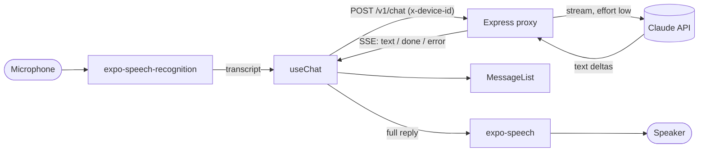

# rn-voice-assistant

Expo voice assistant: platform speech-to-text (on-device on iOS when supported), streamed Claude replies, text-to-speech.

[](https://github.com/Muhaman/rn-voice-assistant/actions/workflows/ci.yml)

## What it does

Tap the microphone, ask a question out loud, and hear a short spoken answer.

- Speech is transcribed by the platform recognizer through `expo-speech-recognition`. On iOS it is forced on-device when the device supports it; on Android it uses the platform recognizer, which falls back to network recognition if no on-device model is installed.
- The transcript and conversation history go to a small Express proxy, which streams Claude's reply back over Server-Sent Events.
- The app renders the reply as it arrives and reads it aloud with `expo-speech` when it is complete.
- The Anthropic API key lives only on the proxy; the app never sees it.

## Architecture



```
app/      Expo (SDK 58) client: App.tsx, src/{api,hooks,components,theme}, __tests__
server/   Express 5 proxy: src/{env,app,index,llm,chat}.ts, test/, Dockerfile
```

## Quickstart

`expo-speech-recognition` is a native module, so the app needs a **development build**. Expo Go will not work.

Proxy:

```bash
cd server
cp .env.example .env        # set ANTHROPIC_API_KEY
npm install
npm run dev                 # http://localhost:3000
```

App:

```bash
cd app
npm install
# Physical device or Android emulator: point expo.extra.apiUrl in app.json at your machine's
# LAN address (http://<lan-ip>:3000). The iOS simulator can use http://localhost:3000.
npx expo run:ios            # or: npx expo run:android
```

Docker (proxy only):

```bash
docker build -t rn-voice-assistant-server server
docker run --rm -p 3000:3000 -e ANTHROPIC_API_KEY=... rn-voice-assistant-server
```

## Usage / API

`POST /v1/chat` requires an `x-device-id` header (uuid) and a body of 1 to 50 messages (the first from the user), each 1 to 4000 characters.

```bash
curl -N http://localhost:3000/v1/chat \
  -H 'content-type: application/json' \
  -H 'x-device-id: 0b5f6f9e-6a63-4c55-9d4c-3f6f2f9f6a11' \
  -d '{"messages":[{"role":"user","content":"What is the capital of France?"}]}'
```

The response is `text/event-stream`:

```
event: text
data: {"text":"The capital of France is Paris."}

event: done
data: {}
```

A refusal, a truncated reply, an empty reply or an upstream failure arrives as `event: error` with `{"code","message"}` (`refusal`, `max_tokens`, `empty_response`, `upstream_error`). Validation failures are `400` JSON, and the limit of 30 requests per minute per device id answers `429` JSON: `{"error":{"code":"rate_limited","message":"Too many requests."}}`. `GET /healthz` is outside the rate limit.

Server configuration: `ANTHROPIC_API_KEY` (required, checked at startup), `ANTHROPIC_MODEL` (default `claude-opus-5-5`), `PORT`, `LOG_LEVEL`, `CORS_ORIGINS`.

## Design decisions & trade-offs

- **Proxy instead of calling Anthropic from the app.** A key shipped in a mobile binary can be extracted. The proxy keeps it server-side and is where rate limiting lives.
- **SSE over `expo/fetch`.** React Native's built-in `fetch` does not expose a streaming body; `expo/fetch` does, so the reply renders token by token without a WebSocket.
- **Short, spoken-style answers at `effort: "low"`.** The system prompt asks for one to three plain sentences with no markdown, and low effort keeps time to first word short. The reply is spoken only after it completes, which avoids reading half a sentence.
- **Disconnects cancel the model call.** When the client goes away (including the user cancelling), the response `close` aborts the upstream request through an `AbortSignal` so tokens are not generated for nobody.
- **Refusal fallback is model-gated.** The server-side fallback beta is sent only for `claude-opus-5-5` and `claude-sonnet-5-5`; other models (for example Haiku) get no `fallbacks`, and a refusal becomes an `error` event either way.
- **Device id is a rate-limit key, not authentication.** It is generated per app session, so anyone can mint new ones. Treat it as abuse smoothing and put real auth in front before exposing the proxy publicly.

## Testing

```bash
cd server && npm install && npm test   # vitest
cd app && npm install && npm test      # jest-expo + React Native Testing Library
```

Server: valid stream, validation (51 messages, a conversation not starting with a user message, empty or oversized content, missing or malformed device id), disconnect aborting the upstream signal, refusal, `max_tokens`, empty reply, typed LLM failures, per-device 429 JSON, health check, env validation, and the Claude wrapper against a stub client (including the fallback gating).
App: `MicButton` labels, press and disabled state; `MessageList` ordering; `useChat` chunk accumulation, alternating user-first history (including trimming past 50 messages) and failure handling; the SSE parser (split chunks, CRLF, multi-line data, comments, error events, early close, malformed JSON, reader release); `useVoice` against a mocked `expo-speech-recognition`.

CI runs both suites plus lint, type-checks and a Docker build of the proxy. It does not build native binaries, so behaviour on a real device (recognizer, audio session, streaming over the real `expo/fetch`) is untested here.

## Limitations & next steps

- Not exercised on a device or simulator by CI; the SSE parser is unit-tested, but the real `expo/fetch` streaming path is not.
- Turn-based only: no barge-in, no continuous conversation, and replies are spoken once complete rather than sentence by sentence.
- Conversation history lives in memory; the proxy is stateless and resends the last 50 messages each turn.
- English only (`en-US`) for both recognition and speech.
- Next: persist the device id, sentence-level TTS streaming, and cancellation from the UI while thinking.

## License

MIT
